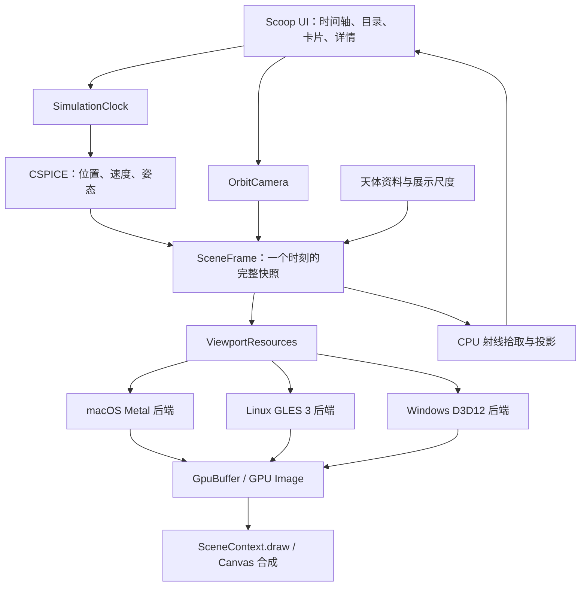

# 太阳系展示程序设计

日期：2026-11-24；2026-11-25 增补 Linux 与 Windows。状态：macOS Apple Silicon 首版已实现，Linux x86_64（GNU、GTK 4／Wayland、GLES 3）与 Windows x86_64（MSVC UCRT、D3D12）已实现；本文记录产品行为与模块边界，实测范围见 [实施与验收](IMPLEMENTATION.md)。

## 1. 范围与基本选择

用户已确认：

- 使用现有 Scoop UI，在 Scoop 仓库旁建立独立项目。
- 场景可以缩放、旋转和平移。
- 场景下方有浮动时间轴，支持修改时间、运行／暂停及时间比例；天体位置与显示时间一致。
- 天体具有符合各自真实外观的形象，并放大尺寸以便观察。
- 小行星带允许简化。
- 每个独立天体有悬浮基本信息卡，卡片的详情按钮打开详细信息弹层。
- 首期加入木星、土星等行星的主要卫星。
- 加入光照模型，太阳作为光源。
- 首期可以只支持 macOS，但须保留实际可移植的模块边界。
- 2026-11-25 用户要求增加 Linux 支持；验收使用 Wayland 显示 `wayland-0`。
- 2026-11-25 用户要求增加 Windows 支持。

采用 Scoop 应用与 UI、CSPICE 天文计算、macOS Metal／Linux GLES 3／Windows D3D12 场景渲染的组合。现有 GPU 纹理接口、窗口、事件、控件和弹层继续复用。新增的渲染器只服务球体／少量不规则天体、星环、轨道及粒子，不扩展为通用游戏引擎。

首期独立天体共 31 个：

| 系统 | 独立展示对象 |
| --- | --- |
| 恒星、行星及矮行星 | 太阳、水星、金星、地球、火星、木星、土星、天王星、海王星、冥王星 |
| 地球、火星 | 月球、火卫一、火卫二 |
| 木星 | 木卫一 Io、木卫二 Europa、木卫三 Ganymede、木卫四 Callisto |
| 土星 | 土卫一 Mimas、土卫二 Enceladus、土卫三 Tethys、土卫四 Dione、土卫五 Rhea、土卫六 Titan、土卫八 Iapetus |
| 天王星 | 天卫一 Ariel、天卫二 Umbriel、天卫三 Titania、天卫四 Oberon、天卫五 Miranda |
| 海王星、冥王星 | 海卫一 Triton、冥卫一 Charon |

小行星带作为集合展示，并提供集合说明；其示意粒子不冒充具体编号小行星。未列出的数百颗小卫星、彗星和航天器不进入首期。

## 2. 界面与操作

### 2.1 画面组织

深色背景下，3D 场景占据主窗口。左上提供太阳系／内行星／当前行星系统视图入口和可收起的天体目录；右上提供复位、轨道与标签显示控制。底部时间轴悬浮于场景上，保留足够边距；窗口较小时换行排列控制，不把按钮挤出窗口。

```text
┌─────────────────────────────────────────────────────────────┐
│ 太阳系 ▾  内行星  行星系统                 轨道  标签  复位 │
│                                                             │
│   天体目录                  3D 场景                         │
│   可收起                     太阳照明                       │
│                                          ┌───────────────┐  │
│                                          │ 土星  Saturn  │  │
│                                          │ 基本信息      │  │
│                                          │ 查看详情      │  │
│                                          └───────────────┘  │
│        ┌────────────────────────────────────────────┐       │
│        │ 日期／时间 UTC       运行／暂停    时间倍率 │       │
│        │ 时间刻度 ────────────●─────────────────── │       │
│        │ 回到现在       时间窗口            展示比例 │       │
│        └────────────────────────────────────────────┘       │
└─────────────────────────────────────────────────────────────┘
```

画面标注“天体大小与卫星间距采用展示比例”。动态距离和详情数据仍使用真实物理值。背景星空只营造空间感，不承诺随日期变化的精确恒星观测星图。

### 2.2 相机

| 输入 | 行为 |
| --- | --- |
| 鼠标左键拖动 | 围绕当前观察中心旋转 |
| 鼠标中键拖动、Shift＋左键拖动 | 沿视平面平移 |
| 滚轮、触控板捏合 | 对数步进缩放，速度与观察距离相适应 |
| 触控板横向滚动 | 平移场景，与时间轴滚动按命中区域区分 |
| 点击场景后按方向键 | 沿视平面平移；按住 Shift 使用较小步长 |
| 点击天体或目录项 | 选择对象；再次执行聚焦操作进入对应系统 |
| 双击天体、资料面板的近观按钮 | 进入近景，并跟随该天体随时间移动 |
| 复位 | 回到当前视图的默认角度和范围 |

相机使用观察中心、距离、方位角和仰角，保持黄道北向为上方；平移作用于观察中心。缩放下限由聚焦天体的展示半径决定，滚轮与触控板共用约束，不穿入聚焦天体。聚焦行星时显示其主要卫星，聚焦卫星时仍可返回母星系统。选择、悬停和相机跟随是三个独立状态。

首版最小窗口为 800 × 640 逻辑像素。宽度小于 1100 时缩短工具栏标题，选中天体的详情入口移到工具栏，底部辅助说明换行，右侧资料面板收起；目录仍可独立收起。

时间轴、卡片和弹层消费自己的输入，不能同时触发相机拖动。模态弹层打开时停止场景输入。目录提供键盘选择和详情入口，使全景中尺寸很小或被遮挡的天体仍可访问。

### 2.3 悬浮卡片与详情

悬停约 200 ms 显示卡片，离开后保留约 250 ms 的过渡时间；移动到卡片或其过渡区域时保持打开。使用现有 HoverCard 的焦点、过渡走廊和边缘避让能力。卡片至少包含中文名／英文名、类别、所属系统、真实半径、轨道周期、当前真实距离和“查看详情”。太阳使用适用的恒星信息替代绕太阳距离等字段。

场景中的 3D 拾取负责确定天体，2D 锚点只负责卡片位置。不能简单给每个投影圆盖一个矩形按钮，否则重叠和遮挡会选错对象。实现时由当前命中对象对应的稳定 UI 锚点连接 HoverCard／Portal；锚点随 Accepted 帧更新。卡片打开后允许停驻于便于点击的位置，移入卡片期间保持对象身份，避免快速运动使详情按钮逃离鼠标。

详情使用现有 Dialog，包含较大的天体图像、简介、物理参数、轨道／自转信息、主要表面特征、所属系统和数据／图像来源。未知或不适用的字段明确标注，不填造出的数值。气态行星的“自转周期”、地球的恒星日与太阳日等采用有名称的具体量。

打开详情时临时暂停模拟并冻结最近已呈现帧的时间，关闭后恢复打开前的播放状态；原本暂停则继续暂停。焦点进入弹层，Escape 关闭，关闭后返回选中天体的稳定详情入口（浮卡可能已经关闭）。首期详情使用静态或打开时生成的预览，避免为阅读信息再维持一个独立渲染循环。

## 3. 时间与天文状态

### 3.1 离线星历

采用 NASA/JPL NAIF CSPICE 读取官方 SPK 星历。首期目标区间为 **1900-01-01 至 2100-01-01 UTC**，具体内核及筛选规则见 [数据与资源](DATA-AND-ASSETS.md)。这个区间允许观察一个完整的海王星公转量级；冥王星的完整参考轨道通过当前状态的轨道要素绘制，不靠越界查询补齐。

使用同一时刻的几何位置：`ECLIPJ2000` 惯性坐标、公里／秒、`abcorr = NONE`。这是一张同时刻的太阳系模型，位置不随观察者切换为带光行时的天空视位置。物理层保存 Double 精度的位置与速度；行星系统质心和行星本体采用各自明确的 NAIF 身份，不能把 5 当作木星本体 599。

UTC 输入由 CSPICE 的闰秒表转换为 TDB／ET；内部时间采用相对 J2000 的 Double 秒数。体固连坐标及自转／轴倾角来自适用的 PCK 姿态模型。纹理的经度方向和零经线必须适配该坐标；不能把所有球体都当作沿屏幕竖轴旋转。SPICE 的全局 kernel／错误状态限定在一个 owner 线程使用。

实际内核覆盖区间、body identity、参考中心、姿态与加载顺序在资源准备时核对一次。程序启动加载已准备资源，按正常错误合同报告缺失或不相容数据；日期越界直接在时间输入边界处理，不退回随意的匀速圆周运动。

运行期仅以只读方式打开星历。固定使用的 CSPICE N0067 的 f2c 文件层默认先尝试 `r+b`／`r+`，薄适配将本进程的现有文件模式设为 `rb`／`r`，避免读取已签名应用包时申请不必要的写入权限。准备脚本所用的独立 SPK 工具保持原有读写能力；升级 Toolkit 时需重新核对这一局部适配。

### 3.2 模拟时钟

时间控制器采用锚点模型：

`simulationTime = anchorSimulationTime + rate × (monotonicNow − anchorMonotonicTime)`

`rate` 的含义为每个真实秒经过多少模拟秒。切换倍率、暂停和恢复前先计算当前模拟时刻，再重设锚点；避免切换时跳变，也避免依赖 FPS 累加角度产生漂移。

- 初次启动显示当前时刻，默认暂停，用户点击运行后按已显示的倍率播放。
- 倍率预设：实时、1 小时／秒、1 天／秒、30 天／秒、1 年／秒、10 年／秒；显示明确单位，支持反向播放。
- 时间轴支持拖动定位和直接输入日期时间；提供“现在”操作，以及日／月／年／世纪量级的可见窗口，避免把 200 年全部挤在一个滑杆中。
- 播放即将超出时间轴可见窗口时自动重定中心，游标继续对应当前时刻。
- 拖动时临时暂停，按最新目标时刻更新；放开后恢复原播放状态。取消拖动恢复开始时刻和原状态。
- 到达数据边界后停在边界并暂停，显示原因；不循环跳回另一个世纪。
- 高倍率仍按对应瞬间采样，不能把一帧内多次公转误当作需要逐步积分的任务。观察卫星时可提示使用较低倍率，但不静默修改用户选择。
- 窗口隐藏／最小化时停止计算和绘制，逻辑运行中的时钟保留锚点；恢复时一次计算当前时刻。暂停则完全保持不变。

每一帧只取一个模拟时刻，生成一个完整 `SceneFrame`：物理位置、姿态、展示变换、相机、光照、标签锚点、可拾取信息。纹理和对应的拾取快照仅在同一 UI 帧 Accepted 后一起成为可交互状态。时间轴游标、画面和卡片的动态距离使用同一已呈现时刻。

### 3.3 轨道线

位置始终来自 SPK。显示用参考轨道由当前相对状态及引力参数，经 CSPICE `oscelt_c`／`conics_c` 生成椭圆折线，保持偏心率、倾角、近地点方向，并经过当前状态位置。卫星使用所属系统的适当中心，冥王星／卡戎保留共同质心关系。

这些线表达当前时刻的参考轨道，不将两体近似线宣传为包含全部摄动的长期预报。轨道缓存覆盖当前参考时刻；大幅跳转时间或偏移达到可见程度时更新，颜色和选中高亮不重新计算轨道。线宽以屏幕像素控制，背面线段受深度遮挡，避免全部轨道透过球体。

## 4. 物理尺度与展示尺度

分开维护三类值：物理位置与半径、用于渲染的坐标与半径、屏幕投影与命中范围。详情中的距离、速度和周期均从物理层取得。

1. 行星间距默认保持线性 AU 比例。通过太阳系总览、内行星和局部行星系统视图解决跨度问题，不用非线性径向压缩把真实椭圆扭曲。
2. 球体半径使用单独的展示映射，例如按真实半径的幂函数压缩大小差异，再按视图设置整体倍率；保持大小排序，设置太阳和气态巨行星的适当上限。具体常数用首个可运行场景调校。
3. 远景为小天体补充最小可辨认的标记和可读标签。标记只是定位辅助；放大后过渡到有纹理的球体，不把整颗行星无限放大为遮挡邻近轨道的物体。
4. 卫星相对于所属系统中心的偏移使用一个共同的局部放大系数。该系数保持同一系统内的轨道方向、偏心率、相对距离和相位，并使近距离卫星位于放大母星之外。该系统中的本体与质心位移使用同一变换。
5. 冥王星／卡戎两者围绕共同质心运动；展示缩放不能把冥王星钉死后让卡戎独自绕它转。其他系统也不混用本体和系统质心。
6. 极远处的卫星不堆成一片标签；进入对应系统后展开。系统切换时同时更新相机与共同展示尺度，时间跳转直接呈现所选时刻；相机跟随保留用户已有的观察偏移。重叠标签优先保留选中天体，其他天体仍可由标记或目录访问。

采用相机附近的渲染原点，将 Double 位置减去该原点后再转换为 GPU Float。近远裁剪面随当前视图设定，保证太阳系总览和卫星近景均有可用的深度精度。展示放大不修改星历、物理半径或时间速度。

## 5. 太阳光照与真实外观

### 5.1 主光与颜色

太阳是唯一的场景主光源。太阳表面为自发光材质，外加克制的辉光；其余天体使用真实太阳位置和真实表面位置计算入射光，形成随时间和自转变化的昼夜分界。背景星点不提供额外场景照明。用于绘制的放大半径、卫星间距与相机坐标不参与光照几何。

普通天体采用金属度为零的粗糙介质材质：漫反射、受控的镜面反射、表面法线和粗糙度。地球海洋与陆地可有不同粗糙度；岩石、冰面和气态表面使用各自参数。不能只把彩色照片贴到无光照球体上。

颜色纹理以 sRGB 采样、在线性空间参与照明，灰度地图显式扩展到 RGB；法线与云层透明度作为线性数据。片元内部计算高亮，经亮度压缩和一次 sRGB 编码写入 BGRA8 目标，再由 Scoop 合成到 SDR 窗口。太阳辉光使用受深度测试的柔和点精灵，首版没有额外的 HDR 或后处理渲染图。

太阳距离提供照度基础，但展示模式需要对内外行星巨大的亮度差做压缩，使海王星仍可辨认。保持受光方向、明暗形状及太阳相对最亮的关系；不把显示像素亮度作为真实辐照度。夜面保持明显昏暗，不使用强环境填充光抹掉昼夜分界。

### 5.2 阴影和星环

首期处理母星对卫星、卫星对母星和天体间遮挡，以及土星球体与星环的相互投影。照明与阴影使用同一时刻 SPK 真实位置、目录中的物理半径和 PCK 姿态。每个放大模型表面的点映射到真实天体的对应表面点，计算受光后再画回放大模型；星环采用同样的物理／展示分离。全景、局部系统与详情预览共用这一规则，隐藏卫星仅影响可见几何，仍可在真实位置参与遮挡。

C ABI 同时传递展示坐标／半径与物理坐标／半径（km），并单独传递可见性。原生端以当前接收天体的物理中心为原点，先用 Double 相减，再转为 GPU Float，避免从 AU 量级 Float 坐标相减丢失卫星阴影的精度。全部 31 个对象使用短数组，不建立全太阳系阴影贴图。

太阳按真实半径形成有限大小的光源。以片元处太阳和遮挡天体的视圆盘重叠比例计算可见日面，表现本影、半影与环食余光，不能用一点光源的二值硬影代替。非球形遮挡物采用物理包围球近似；多个遮挡物的透光比例相乘。星环使用真实尺度的环平面交点和径向透明度采样，环影边缘仍采用太阳中心方向的近似。

土星环至少表现内外半径、主要明暗带、卡西尼缝、正确倾角与透明度；星环的正反面都可见。天王星的细暗环在近景显示。半透明环和云层按明确的深度／混合顺序绘制，不能让近侧环错误地从行星背后穿出。

改变展示尺寸或卫星间距不能改变是否发生遮挡及其在真实表面的位置。展示视图中的大小和间距仍是示意，不能从屏幕上的排布反推日月食。几何状态、平均半径、包围球、有限日面及 IAU 姿态仍有近似，精确日月食接触时刻和地面路径预报不属于首期承诺。

### 5.3 外观规则

| 对象 | 首期外观重点 |
| --- | --- |
| 太阳 | 可见光色调、自发光、细节纹理与适度辉光；活动纹理作为代表外观 |
| 水星、月球、岩质卫星 | 地形色差、撞击坑和适度法线细节 |
| 金星 | 外部观察到的黄白色云层；不把雷达地表图当作裸眼外观 |
| 地球 | 海陆颜色、云层、极区和薄大气边缘；云纹不声称是指定日期的天气 |
| 火星 | 红褐地表、明暗区和极冠 |
| 木星、土星 | 合理色调的云带、大红斑／土星环；大气纹理不声称重建历史天气 |
| 天王星、海王星 | 使用注明处理方式的近自然色素材，避免照搬强增强色图 |
| Io、Europa、Ganymede、Callisto | 硫黄色地表、冰裂纹、混合冰岩及撞击坑等可区分特征 |
| Titan、Iapetus、Miranda 等 | 云雾外观、两半球明暗差异、断崖等主要可识别特征 |
| 冥王星、Charon | 实测近自然色与已成像区域；未知地表明确属于低细节或重建区域 |
| 火卫一、火卫二 | 三轴椭球或适当低面数不规则形状，避免画成大型光滑球 |

资源使用未带固定方向照明的颜色／反照率地图；有可靠数据时使用法线或高度图。纹理与姿态的经纬方向、色彩空间及采样接缝须逐项核对。不能用生成式图像补造地理特征后当作实测外观。

## 6. 小行星带

使用固定种子生成 2,200 个代表性粒子，分布于火星与木星之间，含适当的偏心率和轨道倾角。数量只是画面密度，不表示真实小行星总数。

每个代表粒子有固定轨道参数，位置由同一模拟时刻求值；拖回相同时间得到相同画面。首版采用一次 GPU 点绘制，以平均反射外观表示小行星，不单独渲染其自转、形状和阴影。不给每颗粒子创建 Component、输入区域或详情记录。可以选择整条小行星带查看集合信息。

## 7. 实现结构与平台接口

### 7.1 数据流



本应用的实际模块边界如下；这些应用类型不属于 Scoop 内置 API：

| 边界 | 输入／输出与职责 |
| --- | --- |
| `Ephemeris` | 接收模拟时刻及明确的天体身份，返回物理位置、速度和姿态；拥有已加载星历 |
| `SceneFrame` | 保存一次求值的时间、相机、物理与展示结果、光照及投影信息 |
| `ViewportResources` / `solar_renderer_*` | 在给定原生设备创建；按像素尺寸准备目标；将 SceneFrame 编码到借入纹理；关闭自己持有的资源 |
| `OrbitCamera` | 将通用输入转为观察中心、姿态、距离和投影；不接触 Metal |
| `pick` | 以已 Accepted 的帧做射线与球体／椭球／星环求交，选择最近可见对象 |
| `bodyCatalog` | 稳定 BodyId、NAIF 映射、物理量、说明文本、纹理资料和来源 |

macOS 使用 Metal renderer，Linux 使用 Scoop 现有的 GLES 3 路径，Windows 使用 Scoop 现有的 D3D12 路径；三者实现同一份 `solar_renderer.h` 纯 C 数据接口，并通过 Cone 的目标源码选择接入。原生句柄借用只集中在 `platform/<os>/backend.scoop`：它选择目标纹理格式、从 `NativeGpuDevice`／`NativeGpuTexture` 取得 Metal device/queue/MTLTexture、EGL display/context/texture name 或 D3D12 device/direct queue/ID3D12Resource 与当前 resource state，并负责关闭时的上下文要求；`src/render/renderer.scoop` 只保留与平台无关的缓存、上传和拾取帧同步。UI 与天文逻辑不含 Metal、EGL、GL 或 D3D 类型。不承诺尚未接入的 Vulkan 后端。不建立后端注册系统、可加载插件或通用渲染图。

Linux 后端与 Metal 后端保持同一画面合同：

- 着色器 `native/shaders/solar.glsl` 是 `solar.metal` 的 GLSL ES 3.00 逐项翻译，五个程序（表面、星环、轨道、粒子、太阳辉光）、std140 uniform 布局、光照、有限日面阴影与环影算法不变；由同一嵌入脚本生成 `native/linux/shaders.c`。
- 目标纹理为 `GL_RGBA8`（Skia 解释为 RGBA8、sRGB），着色器自行 sRGB 编码，与 Metal 的 BGRA8Unorm 一致。Skia 的 GPU buffer 以左上为原点，GL 自下而上光栅化，因此投影翻转裁剪空间 y。
- 沿用反向 Z（清除为 0、`GEQUAL`）。设备提供 `GL_EXT_clip_control` 时设为 `[0, 1]` 深度并在返回前恢复；否则在投影中把同一深度值映射到 GL 的 `[-1, 1]`。
- 纹理由系统 GdkPixbuf 解码（GTK 4 的既有依赖），颜色图与星环图使用 `GL_SRGB8_ALPHA8`，法线图和云层遮罩使用线性 `GL_RGBA8`，加载时生成 mipmap；灰度图展开为 RGB，地球云层透明度位于 alpha。超过 `GL_MAX_TEXTURE_SIZE` 的地图按比例缩小。
- 渲染只在 `withNativeWrite` 借出的当前 EGL context 中进行，结束后解除对借入纹理的引用并恢复默认绑定。GL 对象只能在该 context 当前时删除，所以 Linux 的关闭经 `GpuDevice.withNative` 借用后执行。

Windows 后端同样保持该画面合同：

- 着色器 `native/shaders/solar.hlsl` 是同一算法的 HLSL（Shader Model 5.1）翻译，五条管线、uniform 布局（列主序，与 std140 相同，末尾追加目标像素尺寸）、光照、有限日面阴影与环影不变；由同一嵌入脚本生成 `native/windows/shaders.cpp`，创建时用 Windows 自带的 `d3dcompiler_47` 编译，不随包附加编译器。
- 目标纹理为 `DXGI_FORMAT_B8G8R8A8_UNORM`（Skia 解释为 BGRA8、sRGB），着色器自行 sRGB 编码，与 Metal 一致。D3D12 与 Skia 纹理都以左上为原点、深度 `[0, 1]`，投影与 Metal 相同，沿用反向 Z（清除为 0、`GREATER_EQUAL`）。
- D3D12 没有点精灵：星空、小行星带和太阳辉光在顶点着色器中把每个点展开为同像素尺寸的屏幕空间四边形，片元仍按原 point coordinate 计算圆形衰减。
- 渲染器 AddRef 借出的 device 与 direct queue，在 `withNativeWrite` 内把命令提交到同一队列：先把借入纹理从给定 state 转到 RENDER_TARGET，结束（包括失败路径）恢复原 state；每帧 uniform／轨道顶点写入 3 份轮换的上传缓冲，由自己的 fence 保证 GPU 用完前不覆盖。深度纹理按像素尺寸替换，旧纹理由在途帧持有到完成。关闭时只等待自己的 fence，不需要借用。
- 纹理由系统 WIC 解码为 RGBA8，颜色图与星环图使用 `R8G8B8A8_UNORM_SRGB`，法线图和云层遮罩使用线性 `R8G8B8A8_UNORM`；灰度图展开为 RGB，地球云层透明度位于 alpha。D3D12 没有自动 mipmap，加载时在 CPU 以 2×2 盒式滤波生成完整 mip 链，sRGB 颜色在线性光中平均。上传在 `GpuDevice.withNative` 借用内提交到共享队列并等待一次，随后释放暂存缓冲。超过 16384 的地图按比例缩小。
- 资源位于程序目录的 `resources/solar`（`scoop bundle` 的 Windows 布局）；CSPICE 以 ANSI `fopen` 打开内核，路径含非 ASCII 字符时改用系统 8.3 短路径，使 Scoop、WIC 与 CSPICE 读取同一位置。

### 7.2 Scoop 与 native 的职责

- Scoop：应用入口、组件树、状态、模拟时钟、相机数学、展示尺度、拾取、信息内容与资源拥有关系。
- CSPICE 薄 C 适配：加载已准备内核，转换时间，查询位置／姿态及参考轨道；转换原生错误，不复制天体力学实现。
- Objective-C / C／Metal、C／GLES 3、C++／D3D12：设备与管线、GPU mesh／texture、深度、光照／阴影、星环、粒子及输出合成。C++ 只用于 Windows 适配，对 Scoop 仍暴露同一 C ABI。
- C ABI 传递明确单位的标量、矩阵和有长度的连续记录；native 不保存移动 GC 对象地址。需要异步 GPU 使用的数据先进入 native 拥有的存储。

只建立当前实际调用所需的接口。共用程序化球面网格、有限的表面材质、环网格与实例化小行星已能覆盖本项目；不预先实现模型编辑器、任意场景导入、物理碰撞或实时 N 体积分。

### 7.3 帧、资源与关闭

在真实 GPU Canvas 上一次取得 `GpuDevice`，创建与 UI 相同 context 的 `GpuBuffer`。`SceneContext.draw` 中进入 `withNativeWrite`，向借出的 Metal queue 提交场景命令，再以 GPU `snapshot()` 得到 `Image` 合成。实际 API 合同见 Scoop 的 [GPU 规范](../../scoop/docs/specs/SCOOP-GRAPHICS-GPU-SPEC.md)和[接入说明](../../scoop/docs/ui/infrastructure/NATIVE-GPU.md)。

不能持有跨帧 Canvas，不能缓存 `withNativeWrite` 返回的纹理地址，不能在借用期间重入相同 context 的 Scoop 绘图。旧 Image 的不可变内容由现有写时复制合同保护。正常场景帧不使用 `readPixels()`，也不在每帧等待 GPU 完成。

一个在构造时登记到 ComponentScope 的 Closeable 缓存持有设备、当前输出、渲染器和纹理。尺寸变化替换相关目标，及时释放旧引用；关闭时先终止帧需求和回调，再完成实际 GPU 资源收尾。借用的外部设备和窗口不由组件擅自关闭。

播放通过现有 Surface 帧机会推进。采用现有 UI 的帧完成／请求机制验证持续播放、失败帧、隐藏恢复和暂停；不引入与窗口显示节奏竞争的固定 16 ms 定时器。无场景变化时重用最终 Image，卡片或时间标签变化不必重新渲染 3D。绘制时不写 State；需要发布的 UI 状态在合法的完成／事件阶段处理。

### 7.4 拾取

31 个对象适合 CPU 射线拾取，无需同步 GPU ID 读回。将输入转换到视口局部坐标后，用 Accepted 相机生成射线，按展示几何求最近有效交点；土星环可归于土星。隐藏在母星后的卫星不能被直接穿透选中。

远景标记与文字采用可见性、深度和有限的最小命中范围。重叠时使用明确的深度／距离规则，不能随目录顺序改变结果。详细目录作为访问被遮挡对象的入口，不扩大场景拾取范围去跨越遮挡。

## 8. 性能、交付与验收边界

以 Apple Silicon 的常用桌面窗口为首个验收目标，正常播放争取 60 FPS；具体机器、窗口像素尺寸、帧时间和内存以实测记录。Retina 尺寸按逻辑大小乘 scale 只处理一次。管线与纹理跨帧复用，球面和星环顶点按相同规则在 shader 中生成；轨道要素每 6 个模拟小时或切换系统时更新，曲线在原生端转为相机相对坐标。卫星纹理在进入所属系统时加载。

首个完整版本交付可双击启动的 macOS `.app`，星历、纹理、说明和许可随包提供，断网可使用全部首期功能，工作目录变化不影响资源访问。Linux 交付 `scoop bundle` 生成的 deb：程序位于 `usr/lib/dev.scoop.solar-system/bin/`，资源位于 `usr/share/dev.scoop.solar-system/solar/`，程序按 `/proc/self/exe` 定位资源，不依赖工作目录。Windows 交付 `scoop bundle` 生成的 NSIS 安装器：默认按用户安装，程序与随包的 MSVC C++ 运行库位于安装根，资源位于 `resources/solar/`，程序按自身路径定位资源。已验证 macOS aarch64、Linux x86_64 GNU 与 Windows x86_64 MSVC UCRT；Intel macOS、Rosetta、Linux aarch64、Windows ARM64 及 X11 会话尚未验证，不把模块可移植性当作这些平台已经可用。

实施分为基础闭环、天文与时间、全部天体与展示尺度、外观与阴影、交互及打包五个批次，详见 [实施与验收](IMPLEMENTATION.md)。太阳光照在第一个可见场景即实现，后续只补充材质、遮挡和质量；不会把用户要求的光照留成尾项。

2026-11-24 实现核对：当前 Scoop native 构建支持 ARC Objective-C `.m`，不支持 `.mm`。Metal 适配采用 Objective-C / C；共享场景职责与后续平台接口保持上述定义。
